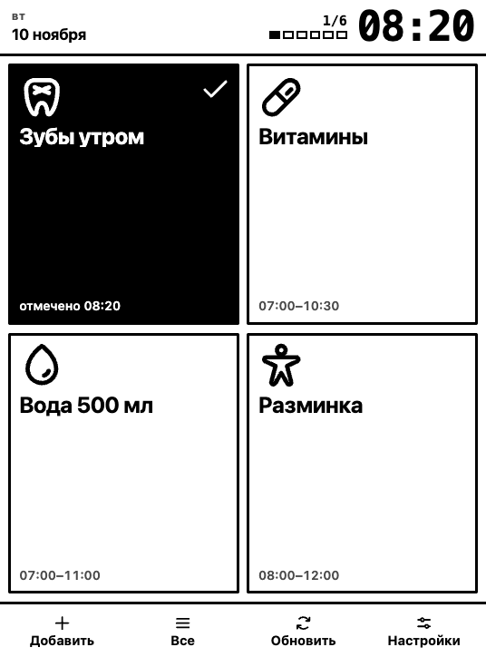

# Takt — مخطِّط عادات لشاشات e-ink

تطبيق صفحة واحدة يعمل محليًا دون اتصال لأجهزة e-ink بمقاس 6 بوصات. بلاطات
كبيرة بلا تمرير، تأشير بلمسة واحدة، والمتأخرات تبقى ظاهرة حتى تُغلق. بلا شبكة،
بلا حسابات، بلا تحليلات: البيانات في متصفح الجهاز.

**نسخة مباشرة:** https://danilka88.github.io/eink-planner/



## ما يفعله

- **لوحة اليوم.** من 1 إلى 4 أعمدة، البلاطات تملأ الشاشة وتُقرأ من متر إلى مترين.
- **العادة في نافذتها.** تظهر عند `06:30`، وبعد `09:30` تصبح
  «متأخر · حتى 09:30» وتبقى حتى التأشير (يمكن إيقاف ذلك).
- **لمسة واحدة** — منجز: تنعكس البلاطة وتختفي بعد 5–60 دقيقة.
- **التكرار:** كل يوم، أيام الأسبوع، يوم من الشهر، تاريخ واحد.
- **السجل والأرشيف.** كل التأشيرات حسب اليوم، مع الإزالة والاستعادة؛ العادات
  المعطَّلة تحتفظ بسجلها.
- **نسخ** العادة بلمسة واحدة.
- **المتأخرات** من الأيام السابقة، تُغلق بأثر رجعي.
- **8 لغات**، سمة فاتحة/داكنة/تلقائية، تصدير واستيراد JSON.
- **دون اتصال:** service worker، وبيان PWA، وصفر طلبات شبكة.

## البدء السريع

```bash
git clone https://github.com/Danilka88/eink-planner.git
cd eink-planner
python3 -m http.server 8080
```

افتح `http://127.0.0.1:8080`.

> فتح `index.html` بنقرة مزدوجة لا يعمل: التطبيق يستخدم وحدات ES والمتصفح
> يحجبها على `file://`.

### التثبيت على الجهاز

1. افتح الموقع عبر **https** (أو `localhost`) — التخزين دون اتصال يعمل هناك فقط.
2. قائمة المتصفح → «إضافة إلى الشاشة الرئيسية».
3. شغّل وضع الطيران وافتح الاختصار: يعمل بلا شبكة.

على `http://192.168.x.x` العادي لا يوجد وضع دون اتصال — هذا قيد المتصفح وليس
عيبًا في التطبيق. الإعدادات → حول التطبيق تُظهر الحالة.

## التحكم

| الإجراء | ما يفعله |
|---|---|
| لمس البلاطة | تأشير / إزالة |
| ضغط مطوّل | محرر العادة |
| ضغط مطوّل على متأخرة | تسجيل تخطٍّ |
| «الكل» → «العادات» | تشغيل، نسخ، تحرير، إضافة |
| «الكل» → «السجل» | حسب اليوم: إزالة، تأشير، تخطٍّ، استعادة |
| «الكل» → «الأرشيف» | استعادة أو حذف نهائي |
| «تحديث» | وميض الشاشة (تنظيف الظلال) |
| «الإعدادات» | السمة، اللغة، تنسيق الوقت، المؤقتات، التجربة، التصدير |

## البنية

```
index.html            الترميز، SEO، القوالب، CSP
styles.css            سمة 1-بت، الشبكة، قواعد e-ink
js/app.js             نقطة الدخول: تجميع الوحدات، init()
js/ui/*.js            اللوحة، الألواح، المحرر، الأحداث، التحديث
js/core/schedule.js   النوافذ، التكرار، المتأخرات (دوال نقية)
js/core/state.js      النموذج، الترحيل، localStorage
js/core/i18n.js       8 لغات، صيغ الجمع، التواريخ، 12/24 ساعة
js/core/dict/*.js     قواميس الواجهة
js/core/icons.js      أيقونات Phosphor Bold
sw.js                 التخزين دون اتصال
tests/                اختبارات الوحدة (node --test)
docs/                 المعمارية، نموذج البيانات، i18n، النشر
```

## الاختبارات

```bash
npm test
```

25 اختبارًا: الجدول، الترحيل، صيغ الجمع في اللغات الثماني، تنسيق الوقت.
انظر `docs/TESTING.md`.

## الخصوصية

لا طلبات شبكة: `connect-src 'self'` في CSP يحجبها على مستوى المتصفح،
والتطبيق لا يُجري أيًّا منها. البيانات في `localStorage` ولا تغادر الجهاز.
انظر `PRIVACY.md`.

## البيانات

- كل شيء في `localStorage` داخل متصفح الجهاز. لا مزامنة.
- **«مشاركة»** تفتح قائمة أندرويد: يذهب الملف مباشرة إلى Telegram أو البريد أو الملفات.
- **«تصدير إلى ملف»** ينزّل `takt-YYYY-MM-DD.json`.
- **«استيراد من ملف»** يستبدل كل المحتوى بعد التأكيد.
- مسح بيانات الموقع يحذف العادات: التصدير هو الشبكة الوحيدة.
- العنوان = التخزين. بعد تغيير العنوان انقل البيانات بالتصدير والاستيراد.

## الترخيص

الشيفرة — MIT (`LICENSE`). الأيقونات — Phosphor Icons، MIT (`THIRD-PARTY.md`).

## لغات أخرى

[Русский](README.md) · [English](README.en.md) · [Español](README.es.md) ·
[Português](README.pt.md) · [Français](README.fr.md) · [中文](README.zh.md) ·
[हिन्दी](README.hi.md)
